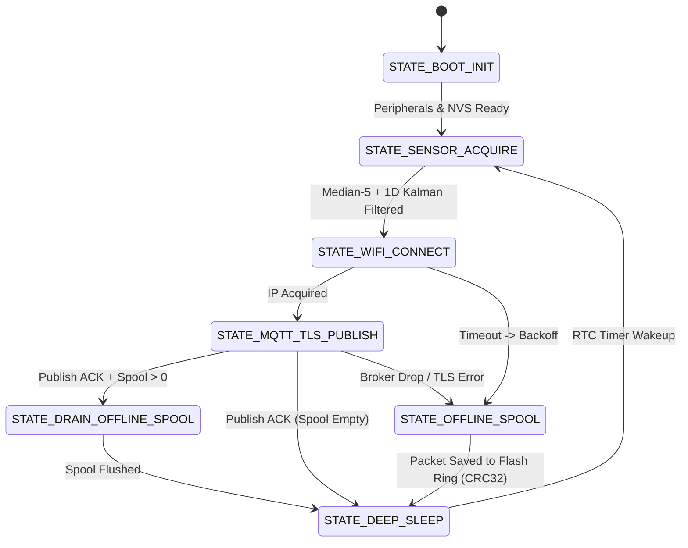

# ESP32 Fault-Tolerant Industrial IoT Telemetry Node (`esp32-industrial-iot-telemetry-node`)

[](https://github.com/Yigitcakirdogan/esp32-industrial-iot-telemetry-node/actions/workflows/ci.yml)
-00599C?style=flat-square&logo=c)


An industrial-grade **ESP32 telemetry node architecture** engineered for harsh factory and remote field environments where **ADC sensor noise**, **intermittent Wi-Fi/cellular connectivity**, and **strict battery/thermal budgets** must be handled deterministically.

---

## Architecture & Deterministic Finite State Machine (FSM)



---

## Core Engineering Modules

1. **Two-Stage Industrial Sensor Conditioning (`sensor_filter.c`):**
   - **Stage 1 — Median-of-5 Impulse Filter:** Rejects single-sample electromagnetic interference (EMI) spikes caused by nearby VFD motor drives or relay switching on `4-20 mA` / `PT100` ADC lines without smearing step edges.
   - **Stage 2 — 1D Discrete Kalman Filter:** Tracks true physical state ($x_k$) while adapting Kalman gain ($K_k$) based on process variance ($Q$) and measurement noise covariance ($R$).
2. **Store-and-Forward Offline Resilience (`telemetry_fsm.c`):**
   - When Wi-Fi or the MQTT/TLS broker is unreachable, telemetry frames are serialized into a compact **24-byte binary frame protected by IEEE 802.3 CRC-32** and pushed into a non-volatile circular spool.
   - Implements **bounded exponential backoff (`1s -> 2s -> 4s ... -> 60s max`)** to prevent battery drain during prolonged outages.
3. **Zero-Malloc Binary & JSON Codec:**
   - Generates both compact binary frames (for LoRaWAN / NVS flash storage) and deterministic JSON payloads (for AWS IoT Core / Azure IoT Hub MQTT topics) using fixed static buffers.

---

## Power Budget Analysis (ESP32-S3 @ 60-Second Reporting Interval)

| Operating Phase | Duration | Average Current | Charge Consumed |
| :--- | :---: | :---: | :---: |
| **Sensor Excitation & 64x ADC Oversampling** | `15 ms` | `28 mA` | `0.42 mAs` |
| **Wi-Fi Fast-Connect (Cached BSSID/Channel) + TLS Publish** | `320 ms` | `115 mA` | `36.80 mAs` |
| **RTC Deep Sleep (`ULP` off, RTC RAM retained)** | `59.665 s` | `14 µA` | `0.83 mAs` |
| **Effective Average Current** | **60.0 s Cycle** | **~0.63 mA** | **>6 Months on 3000 mAh LiFePO4** |

---

## Build & Run Unit Tests

```bash
cmake -B build -DCMAKE_BUILD_TYPE=Release
cmake --build build
ctest --test-dir build --output-on-failure
```

---

## License

Released under the [MIT License](LICENSE).
